<picture><source media="(prefers-color-scheme: dark)" srcset="assets/header-dark.svg"></picture>

<a href="https://github.com/parkminsung45/dotcom-vs-ai-bubble/blob/main/paper/IE412_Report_MinsungPark.pdf">Paper</a>&nbsp;&nbsp;·&nbsp;&nbsp;<a href="https://github.com/parkminsung45/UNIST_Data-Intelligence-Lab-AIGS-">Lab notes</a>&nbsp;&nbsp;·&nbsp;&nbsp;<a href="https://upbit-spread-rl-dashboard.vercel.app">Trading dashboard</a>

UNIST 산업공학과에서 금융공학과 데이터를 공부하고 있습니다. 시장 데이터와 뉴스 같은 텍스트를 함께 보는 문제, 그리고 LLM을 추천과 검색에 붙이는 문제에 관심이 많습니다.

 

<a href="https://github.com/parkminsung45/dotcom-vs-ai-bubble"><picture><source media="(prefers-color-scheme: dark)" srcset="assets/paper-dark.svg">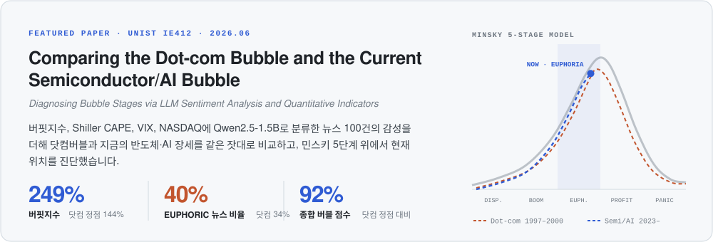</picture></a>

 

### Projects

<a href="https://github.com/parkminsung45/Minsung-Crypto_Currency-Pair-Trading-Investment-Model-"><picture><source media="(prefers-color-scheme: dark)" srcset="assets/cards/upbit-dark.svg">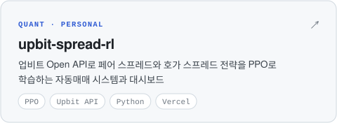</picture></a>
<a href="https://github.com/parkminsung45/ai-investment-journal"><picture><source media="(prefers-color-scheme: dark)" srcset="assets/cards/journal-dark.svg">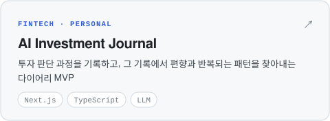</picture></a>

<a href="https://github.com/parkminsung45/Alphapick_-LLM-based-purchase-"><picture><source media="(prefers-color-scheme: dark)" srcset="assets/cards/alphapick-dark.svg">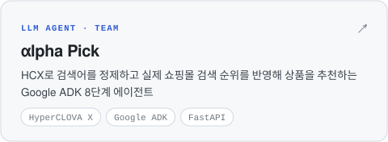</picture></a>
<a href="https://github.com/parkminsung45/multimodality_RAG"><picture><source media="(prefers-color-scheme: dark)" srcset="assets/cards/rag-dark.svg">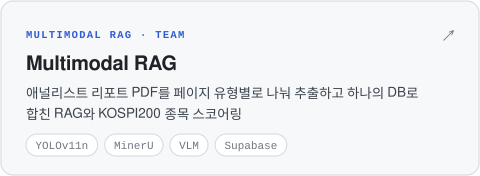</picture></a>

<a href="https://github.com/parkminsung45/keyphrase-extraction"><picture><source media="(prefers-color-scheme: dark)" srcset="assets/cards/keyphrase-dark.svg">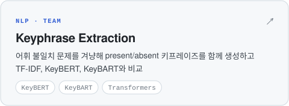</picture></a>
<a href="https://github.com/parkminsung45/oibc-2026-solar-forecast"><picture><source media="(prefers-color-scheme: dark)" srcset="assets/cards/oibc-dark.svg">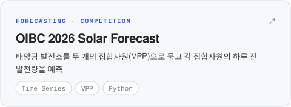</picture></a>

<a href="https://github.com/parkminsung45/GLIP-Yonsei_Nur-Ulsan_Med-UNIST_Digital_Healthcare_Hackathon"><picture><source media="(prefers-color-scheme: dark)" srcset="assets/cards/glip-dark.svg">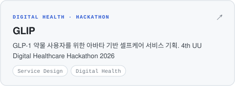</picture></a>
<a href="https://github.com/parkminsung45/UNIST_Data-Intelligence-Lab-AIGS-"><picture><source media="(prefers-color-scheme: dark)" srcset="assets/cards/dil-dark.svg">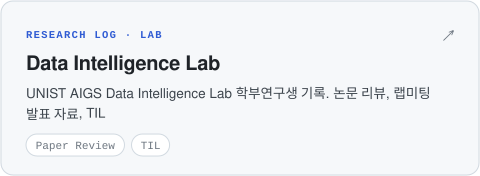</picture></a>

팀 프로젝트에서 맡은 일

 

- **αlpha Pick**: 파이프라인 구조별 비용·성능 벤치마크 설계와 실행, 토큰 사용량 트래킹 버그와 상세검색 facet 오분류 수정, 문서화
- **Multimodal RAG**: KOSPI200 종목 스코어링 파이프라인(재무·뉴스·기술적 지표 결합, 최종 리포트 생성), [발표자료](https://www.figma.com/deck/rJKbTwLwK0yrvTLN2Ysl0G/%EB%A9%8B%EC%82%AC-2%EC%B0%A8-%ED%94%84%EB%A1%9C%EC%A0%9D%ED%8A%B8?node-id=1-341)
- **Keyphrase Extraction**: Baseline과 Proposed 모델 설계, [발표자료](https://www.figma.com/deck/PnqYsZDIRUekmdCaOqXSyQ/%EB%A9%8B%EC%82%AC-1%EC%B0%A8-%ED%94%84%EB%A1%9C%EC%A0%9D%ED%8A%B8?node-id=1-97)

 

### Experience

<picture><source media="(prefers-color-scheme: dark)" srcset="assets/experience-dark.svg">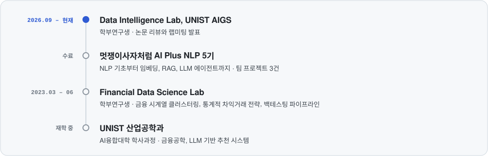</picture>

 

### Tools

pandas · NumPy · Hugging Face Transformers · Streamlit · Tableau
